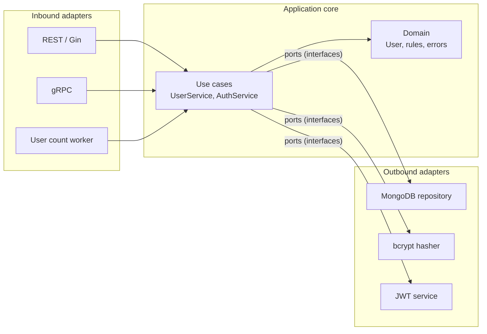

# User Management API

A Go service for managing users. It exposes a REST API (Gin) and a gRPC API,
stores users in MongoDB, authenticates with JWT (HS256), and is structured as
a hexagonal (ports and adapters) application.

Part 2 of the challenge, the **Lottery Search System**, is a design proposal:
[docs/lottery-search-design.md](docs/lottery-search-design.md).

| Document | Contents |
| --- | --- |
| [docs/api.md](docs/api.md) | Sample requests and responses for every REST and gRPC endpoint |
| [docs/authentication.md](docs/authentication.md) | How to get and use JWT tokens |
| [docs/decisions.md](docs/decisions.md) | Design decisions and assumptions, with their trade-offs |
| [docs/lottery-search-design.md](docs/lottery-search-design.md) | Part 2: lottery ticket search and allocation design |
| [docs/postman_collection.json](docs/postman_collection.json) | Postman collection with tests for every REST endpoint |
| [docs/challenge.md](docs/challenge.md) | The original challenge description |

## Contents

- [Requirements coverage](#requirements-coverage)
- [Quick start with Docker](#quick-start-with-docker)
- [Running without Docker](#running-without-docker)
- [Configuration](#configuration)
- [API overview](#api-overview)
- [Authentication](#authentication)
- [Project structure](#project-structure)
- [Testing](#testing)
- [Make targets](#make-targets)
- [Development notes](#development-notes)

## Requirements coverage

| Requirement | Where |
| --- | --- |
| User model (ID, name, unique email, hashed password, created at) | [`internal/domain/user.go`](internal/domain/user.go); unique index in [`mongodb/user_repository.go`](internal/adapters/outbound/mongodb/user_repository.go) |
| Registration and login returning a JWT | `POST /api/v1/auth/register`, `POST /api/v1/auth/login` |
| JWT signed with HS256, validated by middleware | [`outbound/token/jwt.go`](internal/adapters/outbound/token/jwt.go), `RequireAuth` in [`httpapi/middleware.go`](internal/adapters/inbound/httpapi/middleware.go) |
| Create, get, list, update (name/email) and delete users | `/api/v1/users` endpoints, [`application/user_service.go`](internal/application/user_service.go) |
| Official MongoDB Go driver | `go.mongodb.org/mongo-driver/v2`, [`outbound/mongodb`](internal/adapters/outbound/mongodb) |
| Logging middleware (method, path, duration) | `RequestLogger` in [`httpapi/middleware.go`](internal/adapters/inbound/httpapi/middleware.go) |
| Goroutine logging the user count every 10 seconds | [`inbound/worker/user_count.go`](internal/adapters/inbound/worker/user_count.go) |
| Unit tests with the `testing` package, MongoDB mocked | `*_test.go` in every package; the repository is faked in [`application/fakes_test.go`](internal/application/fakes_test.go) |
| **Bonus:** Docker and docker-compose | [`Dockerfile`](Dockerfile), [`docker-compose.yml`](docker-compose.yml) |
| **Bonus:** interfaces abstracting MongoDB | [`application/ports.go`](internal/application/ports.go) |
| **Bonus:** input validation | Gin binding tags and [`domain/validation.go`](internal/domain/validation.go) |
| **Bonus:** graceful shutdown with `context.Context` | [`cmd/api/main.go`](cmd/api/main.go) |
| **Bonus:** gRPC `CreateUser` and `GetUser`, secured with token metadata | [`proto/user/v1/user.proto`](proto/user/v1/user.proto), [`inbound/grpcapi`](internal/adapters/inbound/grpcapi) |
| **Bonus:** hexagonal architecture | See [Project structure](#project-structure) |

## Quick start with Docker

Requires Docker with Compose v2.

```bash
cp .env.example .env
# Set JWT_SECRET in .env, for example to the output of: openssl rand -base64 48
make up        # same as: docker compose up --build -d
make logs      # follow the API logs
```

The REST API listens on `http://localhost:8080` and gRPC on `localhost:9090`.
Try it:

```bash
curl -s localhost:8080/api/v1/auth/register -H 'Content-Type: application/json' \
  -d '{"name":"Alice","email":"alice@example.com","password":"password123"}'

TOKEN=$(curl -s localhost:8080/api/v1/auth/login -H 'Content-Type: application/json' \
  -d '{"email":"alice@example.com","password":"password123"}' | jq -r .access_token)

curl -s localhost:8080/api/v1/users -H "Authorization: Bearer $TOKEN"
```

Every 10 seconds the logs show a `user count` line. Stop everything with
`make down`; MongoDB data is kept in a Docker volume.

## Running without Docker

Requires Go 1.26 or later and a MongoDB server (for example
`docker run -d -p 27017:27017 mongo:8`).

```bash
cp .env.example .env   # set JWT_SECRET
make run               # loads .env and runs ./cmd/api
```

## Configuration

All settings are environment variables. `make run` and Docker Compose read
them from `.env`; see [`.env.example`](.env.example).

| Variable | Default | Description |
| --- | --- | --- |
| `JWT_SECRET` | none, **required** | HMAC key for signing tokens, at least 32 bytes |
| `JWT_TTL` | `1h` | Token lifetime |
| `JWT_ISSUER` | `backend-challenge` | `iss` claim written and checked |
| `HTTP_ADDR` | `:8080` | REST listen address |
| `GRPC_ADDR` | `:9090` | gRPC listen address |
| `GRPC_REFLECTION` | `true` | Enable gRPC server reflection (for grpcurl and Postman) |
| `MONGO_URI` | `mongodb://localhost:27017` | MongoDB connection string |
| `MONGO_DATABASE` | `user_management` | Database name |
| `MONGO_TIMEOUT` | `5s` | Timeout for each database operation |
| `BCRYPT_COST` | `10` | bcrypt work factor |
| `USER_COUNT_INTERVAL` | `10s` | How often the user count is logged |
| `SHUTDOWN_TIMEOUT` | `10s` | Time allowed for in-flight requests on shutdown |
| `GIN_MODE` | `debug` | Set to `release` to silence Gin's debug output |

Invalid values stop the service at start-up with a message listing every
problem.

## API overview

REST (`http://localhost:8080`):

| Method | Path | Auth | Description |
| --- | --- | --- | --- |
| GET | `/healthz` | – | Liveness check |
| POST | `/api/v1/auth/register` | – | Register a user |
| POST | `/api/v1/auth/login` | – | Get an access token |
| POST | `/api/v1/users` | Bearer | Create a user |
| GET | `/api/v1/users?offset=&limit=` | Bearer | List users (default 20, maximum 100 per page) |
| GET | `/api/v1/users/me` | Bearer | Get the authenticated user |
| GET | `/api/v1/users/{id}` | Bearer | Get a user |
| PATCH | `/api/v1/users/{id}` | Bearer | Update name and/or email |
| DELETE | `/api/v1/users/{id}` | Bearer | Delete a user |

gRPC (`localhost:9090`, service `user.v1.UserService`): `CreateUser` and
`GetUser`, both requiring the metadata `authorization: Bearer <token>`.

```bash
grpcurl -plaintext -H "authorization: Bearer $TOKEN" \
  -d '{"id":"<user id>"}' localhost:9090 user.v1.UserService/GetUser
```

Errors share one JSON shape with a stable `code`, for example
`{"error": {"code": "not_found", "message": "user not found"}}`.

Full examples of every request, response and error:
[docs/api.md](docs/api.md). To try the API in Postman, import
[docs/postman_collection.json](docs/postman_collection.json) and choose
**Run collection**.

## Authentication

1. Register with `POST /api/v1/auth/register`.
2. Log in with `POST /api/v1/auth/login` and read `access_token` from the
   response.
3. Send it as `Authorization: Bearer <token>` (REST) or as the
   `authorization` metadata entry (gRPC).

Tokens are HS256-signed JWTs carrying the user ID (`sub`), issuer (`iss`),
issue time (`iat`) and expiry (`exp`, 1 hour by default). The guide in
[docs/authentication.md](docs/authentication.md) covers token contents,
errors, configuration and security notes.

## Project structure

```text
cmd/api/                     composition root: wiring, servers, graceful shutdown
internal/
  domain/                    entity, business rules, domain errors (standard library only)
  application/               use cases (UserService, AuthService) and the ports they need
  adapters/
    inbound/                 drive the application
      httpapi/               REST API (Gin): routes, handlers, middleware
      grpcapi/               gRPC server and interceptors
      worker/                background user-count job
    outbound/                are driven by the application
      mongodb/               UserRepository on MongoDB
      password/              PasswordHasher with bcrypt
      token/                 TokenService with HS256 JWT
  config/                    environment configuration
proto/user/v1/               gRPC contract
gen/user/v1/                 generated gRPC code (make proto)
docs/                        documentation
```



The dependency rule: `domain` imports nothing outside the standard library,
`application` imports only `domain`, and only adapters import frameworks and
drivers (Gin, gRPC, the MongoDB driver, bcrypt, JWT). The application
declares the interfaces it needs in
[`application/ports.go`](internal/application/ports.go); adapters satisfy
them, and [`cmd/api/main.go`](cmd/api/main.go) plugs them together. Because
of this, REST and gRPC share the same use cases, and the use cases are tested
without a database.

## Testing

```bash
make test              # unit tests
make test-race         # unit tests with the race detector
make cover             # tests with total coverage

# MongoDB integration tests: need a running MongoDB, for example from `make up`
MONGO_URI=mongodb://localhost:27017 make test-integration
```

| Layer | What the tests cover |
| --- | --- |
| Domain | Validation and normalization rules |
| Application | Every use case against hand-written fakes of `UserRepository`, `PasswordHasher` and `TokenService` |
| REST | Handlers, status codes, error bodies, auth middleware, logging, panic recovery and body limits, via `httptest` |
| gRPC | Both RPCs, error codes, authentication and recovery, over an in-memory `bufconn` connection |
| Worker | Ticks, error logging and clean shutdown |
| JWT and bcrypt | Real libraries, including rejected tokens: tampered payload, `alg: none`, HS512, wrong secret, expired |
| MongoDB | Document mapping (unit), plus CRUD, unique email and pagination against a real MongoDB (integration, `-tags=integration`) |

MongoDB is mocked at the `UserRepository` port rather than at the driver;
[decision D20](docs/decisions.md#7-testing-strategy) explains why.

## Make targets

```text
make help              list all targets
make run               run locally, loading .env
make build             build bin/api
make up / down / logs  Docker Compose
make test / test-race / test-integration / cover
make vet / fmt
make proto             regenerate gRPC code (needs protoc; plugins via `make tools`)
```

## Development notes

This project was built with AI assistance (Claude) for scaffolding,
implementation and review. I made the design decisions, and reviewed and
tested all code. The reasoning behind each decision is recorded in
[docs/decisions.md](docs/decisions.md).
