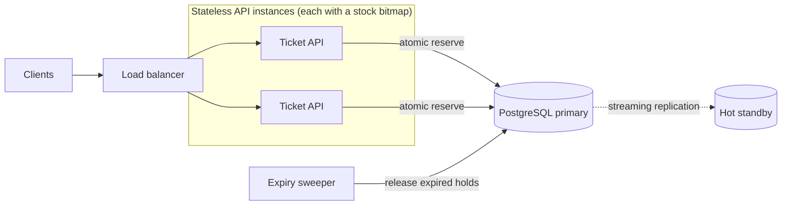
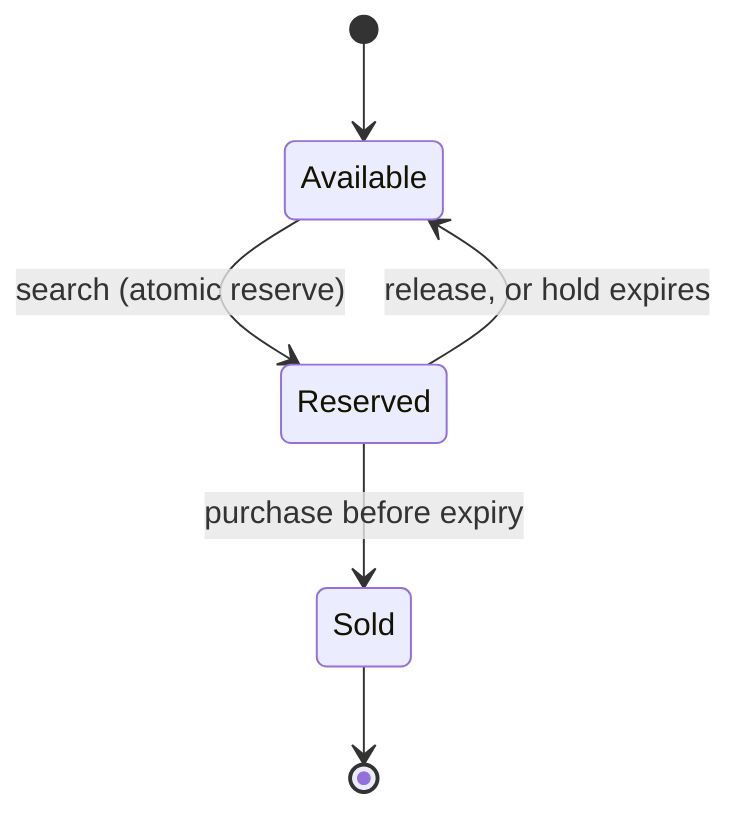
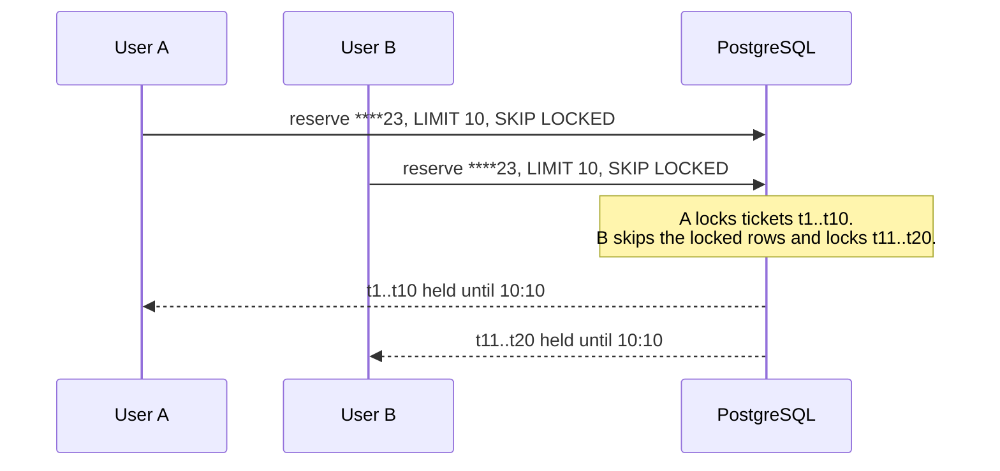

# Lottery Ticket Search: Design Proposal

Design for searching 10 million six-digit lottery tickets by wildcard pattern
(`****23`, `1****5`, `123***`) and handing matching tickets to users so that
no ticket is given to two users at the same time. This is a design only;
there is no implementation.

## Summary

- **Storage:** PostgreSQL. Ticket numbers are stored as integers with a
  partial B-tree index on available tickets.
- **Matching:** the API generates the numbers that match the pattern
  (a pattern with `w` wildcards matches exactly 10^w numbers) and looks them
  up in the index in random order. Because each number has about 10 tickets,
  a search normally needs 1–3 index lookups instead of a scan over 10 million
  rows. An in-memory bitmap of "numbers that still have stock" (125 KB) keeps
  this true as tickets sell out.
- **Distribution:** a search *is* a reservation. One SQL statement selects and
  reserves matching tickets with `FOR UPDATE SKIP LOCKED`, holding them for
  the user for 10 minutes. The row lock is per ticket, so exclusivity holds
  across all patterns, including different patterns that match the same
  ticket.
- **Scale-out:** connection pooling, partitioning, then sharding by number
  range. None of them moves the correctness guarantee out of the database.

## Contents

1. [Requirements and assumptions](#1-requirements-and-assumptions)
2. [Key observations](#2-key-observations)
3. [Architecture](#3-architecture)
4. [Data model](#4-data-model)
5. [Pattern matching](#5-pattern-matching)
6. [Allocation without duplicates](#6-allocation-without-duplicates)
7. [Performance analysis](#7-performance-analysis)
8. [Storage choice](#8-storage-choice)
9. [Scaling and failure handling](#9-scaling-and-failure-handling)
10. [Trade-offs](#10-trade-offs)
11. [How the design would be validated](#11-how-the-design-would-be-validated)
12. [Appendix: API sketch](#appendix-api-sketch)

## 1. Requirements and assumptions

**Requirements**

- 10 million tickets, each with a six-digit number.
- A search pattern is exactly six characters, each a digit or `*`.
- Concurrent users searching the same pattern must not receive the same
  ticket at the same time.
- Searching and allocating must be fast at 10M+ tickets.

**Assumptions** (stated because the requirements leave them open)

| Assumption | Reason |
| --- | --- |
| A ticket is identified by its own ID, not by its number. Many tickets share a number (sets/series, as in the Thai government lottery). | There are only 10^6 six-digit numbers, so 10^7 tickets cannot all have different numbers. On average each number appears 10 times. |
| A search returns a small page of tickets (default `N = 10`), not every match. | `****23` matches about 100,000 tickets; nobody can use, or should be sent, all of them. |
| "At the same time" means "while a reservation is active". A search reserves the returned tickets for the user for a TTL (default 10 minutes). Unbought tickets then return to the pool. | Exclusivity needs a time window to be defined at all. This is how seat booking and flash sales work. |
| Tickets belong to a draw. The set of tickets is loaded once per draw; afterwards only their status changes. | Indexes are built once; only status updates happen during sales. |
| A user may hold a limited number of tickets at once (e.g. 20). | Otherwise one client could reserve the whole pool by searching `******` repeatedly. |

## 2. Key observations

1. **The number space is small.** There are only 1,000,000 possible numbers.
   A bitmap with one bit per number is 125 KB and fits in a CPU cache.
2. **There are 64 pattern shapes** (each of the six positions is fixed or
   wildcard, 2^6), not just the three examples. `*2*4*6` and `12*4*6` must
   work too.
3. **The matching set can be computed, not searched for.** A pattern with
   `w` wildcards matches exactly 10^w numbers, and they can be generated
   directly. For example, `1****5` is `1abcd5` for `abcd` from `0000` to
   `9999`.
4. **Result sizes vary enormously.** With `k` fixed digits a pattern matches
   10^(6−k) numbers, about 10^(7−k) tickets: from 10 million for `******` to
   about 10 for `123456`.
5. **The hard part is allocation, not matching.** Finding matches is cheap
   once indexed. Guaranteeing that two simultaneous requests never get the
   same ticket is the correctness problem.
6. **Different patterns overlap.** `****23` and `1****3` both match
   `100023`. A lock or queue *per pattern* would not prevent two users from
   receiving that ticket. Exclusivity must be enforced *per ticket*.
7. **Naive `LIKE` fails on the searches people actually make.** A B-tree index
   only helps when the pattern starts with fixed digits. `**3456`-style
   "lucky ending" searches would scan most of the table (section 7.5).

## 3. Architecture



- **Ticket API (stateless):** validates the pattern, generates candidate
  numbers, filters them through its copy of the stock bitmap (section 5)
  and executes the reservation statement (section 6). Instances can be added
  freely: the bitmap is only a hint, and allocation state lives in the
  database.
- **PostgreSQL primary:** the single source of truth for tickets, their
  status and their holds. All exclusivity decisions happen here, in one
  statement.
- **Hot standby:** failover target. It does not serve searches, because a
  search is a write.
- **Expiry sweeper:** a periodic job that returns expired holds to the pool.
  It can run on every API instance (section 6.5).

## 4. Data model

```sql
CREATE TABLE tickets (
    id             bigint      PRIMARY KEY,
    draw_id        integer     NOT NULL,
    number         integer     NOT NULL CHECK (number BETWEEN 0 AND 999999),
    set_no         smallint    NOT NULL,
    status         smallint    NOT NULL DEFAULT 0,  -- 0 available, 1 reserved, 2 sold
    reservation_id uuid,
    reserved_by    bigint,
    reserved_until timestamptz,
    sold_to        bigint,
    sold_at        timestamptz,
    UNIQUE (draw_id, number, set_no)
);

-- Searching: only available tickets, ordered by number.
CREATE INDEX tickets_available ON tickets (draw_id, number) WHERE status = 0;

-- Releasing expired holds.
CREATE INDEX tickets_hold_expiry ON tickets (reserved_until) WHERE status = 1;

-- A user's active holds (limit check, purchase, release).
CREATE INDEX tickets_holder ON tickets (reserved_by) WHERE status = 1;
```

Design choices:

- **`number` is an `integer`, not text.** It is 4 bytes, compares quickly, and
  each digit can be computed with integer arithmetic:
  digit at position `i` (1 = leftmost) is `(number / 10^(6−i)) % 10`.
  Leading zeros are only a display concern (`000123`).
- **The search index is partial** (`WHERE status = 0`). Reserved and sold
  tickets leave the index, so the index shrinks as tickets sell, and a scan
  never walks over tickets that cannot be given out.
- **`(draw_id, number)`** keeps each draw's tickets contiguous in the index
  and ordered by number, which supports all three access methods below:
  range scans, point lookups and ordered scans.

## 5. Pattern matching

### 5.1 Parsing

A pattern is accepted only if it matches `^[0-9*]{6}$`. From it the API
derives:

| Symbol | Meaning | `1****5` | `**3456` |
| --- | --- | --- | --- |
| `k` | number of fixed digits | 2 | 4 |
| `w = 6 − k` | number of wildcards | 4 | 2 |
| `a` | length of the fixed prefix | 1 | 0 |
| `[lo, hi]` | number range implied by the prefix | 100000–199999 | 000000–999999 |
| other fixed digits | checked arithmetically | last digit = 5 | 3rd = 3, 4th = 4, 5th = 5, 6th = 6 |

### 5.2 Two access paths

**Path B, the default: enumerate candidates.** Generate the numbers that
match the pattern, starting from a random one (section 5.5), and look them
up in the available-tickets index in small batches until `N` tickets are
reserved:

```sql
WHERE draw_id = $draw AND status = 0
  AND number = ANY($batch)            -- e.g. the next 20 candidate numbers
LIMIT $n
```

Each number has about 10 tickets, so one or two numbers usually satisfy
`N = 10`, whatever the pattern.

**Path A, the fallback: ordered scan.** Walk the available-tickets index
through the prefix range `[lo, hi]` in number order, keeping tickets whose
other fixed digits match:

```sql
WHERE draw_id = $draw AND status = 0
  AND number BETWEEN $lo AND $hi      -- prefix range: index range scan
  AND number % 10 = 5                 -- remaining fixed digits, generated per pattern
ORDER BY number
LIMIT $n
```

### 5.3 Cost of each path

With `N` tickets wanted and `s` the average number of available tickets per
matching number (about 10 when sales open):

- **Path B** needs about `N / s` lookups while the pattern's numbers have
  stock. At worst, when almost all of them are sold out, it tries all 10^w
  candidates.
- **Path A** examines about `N × 10^(k−a)` index entries, because only one
  available ticket in 10^(k−a) within the prefix range matches the other
  fixed digits. At worst, when the pattern is sold out but its neighbours are
  not, it walks every available entry in the range.

When sales open (`N = 10`, `s ≈ 10`):

| Pattern | k | a | Path A (entries) | Path B (lookups) |
| --- | --- | --- | --- | --- |
| `******` | 0 | 0 | 10 | 1–2 |
| `****23` | 2 | 0 | 1,000 | 1–2 |
| `1****5` | 2 | 1 | 100 | 1–2 |
| `123***` | 3 | 3 | 10 | 1–2 |
| `*2*4*6` | 3 | 0 | 10,000 | 1–2 |
| `**3456` | 4 | 0 | 100,000 | 1–2 |
| `123456` | 6 | 6 | 10 | 1 |

Each path has a bad case, and they are opposite:

| Late in the sale | Path A | Path B without bitmap | Path B with bitmap |
| --- | --- | --- | --- |
| `**3456` sold out, most other tickets available | walks millions of entries, finds nothing | 100 lookups, finds nothing | no lookups: every candidate's bit is 0 |
| `******` with 0.1% of tickets left | about 10 entries | about 1,000 lookups, mostly of sold-out numbers | about 10 lookups |

### 5.4 Stock bitmap

Each API instance keeps one bit per number per draw, set when the number
still has available tickets: 1,000,000 bits, 125 KB. Path B tests a
candidate's bit in memory (nanoseconds) and sends only numbers with stock
to the database, so its cost stays at about `N / s` lookups in every
situation above. Generating and testing all 10^6 candidates of `******` in
memory takes about a millisecond in the worst case, and is usually stopped
far earlier.

The bitmap is maintained cheaply and is allowed to be stale:

- **Built at start-up** from an index-only scan of `tickets_available`
  (a few seconds for 10M entries).
- **A bit is cleared** when a lookup for that number finds no available
  ticket.
- **A bit is set** when tickets return to the pool: the sweeper and the
  release endpoint publish the numbers with PostgreSQL `NOTIFY`, and every
  instance `LISTEN`s.
- **Rebuilt periodically** (for example every few minutes) to correct drift.

Staleness never affects correctness, because the database statement still
checks `status = 0` and takes row locks. A stale 1 costs one wasted lookup;
a stale 0 hides a number until the next update.

**Planner rule:** use Path B with the bitmap. Fall back to Path A while the
bitmap is not loaded yet, choosing between the two by the estimates above.

### 5.5 Random starting point

Both paths start at a random position (a random candidate for Path B, a
random number within `[lo, hi]` for Path A) and wrap around if they reach
the end without finding `N` tickets. Without this, every user searching
`****23` would compete for the same lowest-numbered tickets. With it,
concurrent users usually land on different numbers, so they rarely contend
for the same rows, and the tickets on offer are spread fairly.

## 6. Allocation without duplicates

### 6.1 Ticket lifecycle



### 6.2 The reservation statement

Searching and reserving are one SQL statement. This is the Path B form;
Path A uses the range and digit conditions from section 5.2 instead of
`number = ANY(...)`.

```sql
WITH picked AS (
    SELECT id
    FROM tickets
    WHERE draw_id = $1
      AND status = 0
      AND number = ANY($candidates)   -- next batch of in-stock candidate numbers
    LIMIT $n
    FOR UPDATE SKIP LOCKED
)
UPDATE tickets AS t
SET status         = 1,
    reservation_id = $reservation_id,
    reserved_by    = $user_id,
    reserved_until = now() + interval '10 minutes'
FROM picked
WHERE t.id = picked.id
RETURNING t.id, t.number, t.set_no;
```

If fewer than `N` rows come back (stale bits, or rows locked by other
users), the API sends the next batch of candidates in the same transaction.

### 6.3 Why no ticket can go to two users

1. **No check-then-act gap.** Finding and reserving happen in one statement,
   so no other request can act between "this ticket is free" and "it is
   mine".
2. **Row locks decide.** `FOR UPDATE` locks each selected ticket.
   `SKIP LOCKED` makes a concurrent request skip rows locked by another
   transaction instead of waiting for them. Two users therefore receive
   different tickets, and neither blocks the other.
3. **Committed reservations are re-checked.** If another transaction
   reserved a row and committed after this statement started, PostgreSQL
   (in the default READ COMMITTED isolation) re-evaluates the `WHERE` clause
   against the newest row version before locking it. `status = 0` no longer
   holds, so the row is skipped. Stronger isolation (SERIALIZABLE) is not
   needed and would only add retries.
4. **Exclusivity is per ticket, not per pattern.** `****23` and `1****3`
   both reach ticket `100023` through different conditions, but both need the
   same row lock and the same `status = 0`. Only one can succeed.
5. **Every exit from "reserved" is conditional** (sections 6.4 and 6.5), so a
   hold can never be bought by someone else or released twice.



### 6.4 Purchase and release

Purchase succeeds only for tickets the same user still validly holds:

```sql
UPDATE tickets
SET status = 2, sold_to = reserved_by, sold_at = now(),
    reservation_id = NULL, reserved_until = NULL
WHERE reservation_id = $reservation_id
  AND reserved_by    = $user_id
  AND status         = 1
  AND reserved_until > now()
RETURNING id;
```

Only the returned tickets are sold. If the hold has expired, nothing is
returned and the user is told to search again. In a real payment flow, the
reservation would move to a "payment pending" state before the external
charge, so the sweeper does not release it mid-payment.

Release (the user gives tickets back) is the same conditional update,
setting `status = 0` and clearing the hold columns.

### 6.5 Expiry

A sweeper returns expired holds to the pool every few seconds, in bounded
batches so that no transaction runs long:

```sql
UPDATE tickets
SET status = 0, reservation_id = NULL, reserved_by = NULL, reserved_until = NULL
WHERE id IN (
    SELECT id FROM tickets
    WHERE status = 1 AND reserved_until < now()
    LIMIT 5000
    FOR UPDATE SKIP LOCKED
);
```

`SKIP LOCKED` makes concurrent sweepers safe, so every API instance can run
one and there is no single point of failure. Expiry uses the database clock
(`now()`), never an application server's clock.

### 6.6 Abuse limits

- **Holds per user:** a user may hold at most a fixed number of tickets
  (e.g. 20). The count comes from the `tickets_holder` index inside the
  reservation transaction. This is a soft limit; strict enforcement would
  lock a per-user row.
- **Rate limiting** of searches per user and per IP at the API.
- **Short TTL.** Abandoned holds return to the pool within minutes.
- **Idempotency key.** A client that retries a search after a timeout gets
  its existing reservation back instead of a second one.

## 7. Performance analysis

### 7.1 Memory

| Object | Estimate |
| --- | --- |
| Table rows (about 70–80 bytes each with PostgreSQL overhead) | about 0.8 GB |
| Primary key and `(draw_id, number, set_no)` unique index | about 0.5 GB |
| `tickets_available` partial index (shrinks as tickets sell) | about 0.25 GB |
| Hold indexes (only reserved rows) | negligible |
| **Total** | **about 1.5 GB** |

A primary with 8 GB of RAM keeps the whole working set in memory, so every
index access is a memory access.

### 7.2 Cost per search

| Step | Work | Estimated time |
| --- | --- | --- |
| Parse and plan the pattern | constant | microseconds |
| Generate and filter candidates through the bitmap | in memory, usually far fewer than 10^w | microseconds (about 1 ms worst case) |
| Find tickets in the index | usually 1–3 lookups | well under 1 ms |
| Lock and update the reserved rows | `N` rows (10) | < 1 ms |
| Commit (WAL flush) | one fsync, shared by concurrent commits | ~1 ms |
| **Total** | | **about 1–3 ms** |

Purchase and release update at most `N` rows through an index: well under a
millisecond of database time.

### 7.3 Throughput

Each search is one short write transaction that touches about 10 rows. A
single mid-size primary (8–16 vCPU) should sustain on the order of a few
thousand searches per second, with commit throughput as the limit rather
than matching. This is an estimate; section 11 describes the load test
that would confirm it. Throughput beyond that is covered in section 9.

### 7.4 Behaviour as tickets sell

- With the bitmap, Path B only looks up numbers that still have stock, so a
  search stays at about `N / s` lookups. `s` falls as numbers sell down, but
  an in-stock number has at least one ticket, so this stays at or below
  `N` lookups, plus a few for stale bits.
- Path A's cost does not grow with overall sales, because the partial index
  only contains available tickets. It grows when the pattern's own tickets
  sell faster than their neighbours, which is typical for popular numbers.
- The partial index shrinks as tickets are reserved and sold, which keeps
  every lookup cheap.

### 7.5 Compared with a naive query

```sql
SELECT ... WHERE number_text LIKE '__3456' AND status = 0 LIMIT 10 FOR UPDATE SKIP LOCKED;
```

| Pattern | Naive `LIKE` (no usable index) | This design |
| --- | --- | --- |
| `123***` (prefix) | index range scan: fast | 1–2 lookups |
| `****23` (dense suffix) | scan stops after ~1,000 rows: fast | 1–2 lookups |
| `**3456` (sparse suffix) | ~100,000 rows (~50–100 ms) | 1–2 lookups |
| `**3456`, all sold out | full scan of 10M rows (seconds), returns nothing | no lookups (bitmap) |

The naive approach is fine for exactly the patterns that are easy and fails
for "lucky number" searches. Those are popular and their numbers sell out
first, so the slow case is also the common case near the draw.

## 8. Storage choice

PostgreSQL is the only data store.

| Criterion | How PostgreSQL meets it |
| --- | --- |
| Query performance | The data set (~1.5 GB) fits in memory. B-tree indexes on an integer column serve the range scans, ordered scans and point lookups the planner needs. |
| Concurrency handling | `FOR UPDATE SKIP LOCKED` is built for handing out distinct rows to many concurrent workers without blocking. Row-level locks plus ACID transactions make exclusivity a database guarantee, not application logic. |
| Correctness in one place | Search, reservation, purchase and expiry are all transactions on the same rows. No second system needs to be kept consistent. |
| Operational simplicity | Mature and widely known; managed offerings (RDS, Cloud SQL), point-in-time recovery, streaming replication and failover are standard. |

## 9. Scaling and failure handling

### 9.1 Scaling path, in order

1. **Vertical scaling and connection pooling** (PgBouncer). Keep
   transactions short; this is the cheapest step.
2. **Partitioning** the table by draw, and within a draw by number range (for
   example by first digit). Indexes per partition are smaller, prefix
   patterns touch one partition, and vacuuming works per partition.
3. **Sharding** across several PostgreSQL primaries by number range (with
   Citus or in the application). Every ticket lives on exactly one shard, so
   per-shard exclusivity is global exclusivity. A search visits shards in
   random order until it has `N` tickets.

Read replicas do not help, because every search writes.

### 9.2 Failure modes

| Failure | Effect | Handling |
| --- | --- | --- |
| API instance crashes after reserving | Holds without a client | The TTL releases them |
| User never pays | Tickets held for nothing | The TTL releases them; holds-per-user limit |
| Client times out after the reservation committed | User may not know which tickets they hold | Idempotency key returns the same reservation; an endpoint lists the user's active holds |
| A sweeper stops | Expired holds stay reserved | Sweepers run on every instance; alert on the oldest expired hold |
| Primary database fails | In-flight transactions roll back; a reservation is all or nothing | Failover to the hot standby; clients retry with the same idempotency key |
| Clock skew between API servers | Inconsistent expiry | Only the database clock (`now()`) is used |
| Index bloat from status churn | Slower scans over time | Autovacuum tuned for the tickets table; partitions can be vacuumed separately |

## 10. Trade-offs

| Decision | Benefit | Cost |
| --- | --- | --- |
| Search reserves tickets | Exclusivity is well-defined and enforced | Users who only browse also hold tickets for a while; mitigated by short TTLs and hold limits |
| Database as the only arbiter | One place to reason about correctness | Throughput is bounded by one primary until partitioning or sharding |
| `SKIP LOCKED` | Concurrent users never wait for each other | Results are "some matching tickets", not a stable ordered page |
| Enumerating candidates instead of searching | Every pattern is fast, including sparse and sold-out ones | More logic than a single `LIKE` query |
| Stock bitmap in each API instance | Lookups skip sold-out numbers | Must be built at start-up and kept roughly in sync; it is only a hint, so staleness costs speed, never correctness |
| Integer numbers | Compact, arithmetic digit checks | Zero-padding is handled at display time |
| Random starting point | Less contention, fairer distribution | Results are not repeatable between searches |

## 11. How the design would be validated

- **Correctness under concurrency:** a test that runs hundreds of concurrent
  searches with overlapping patterns against a real PostgreSQL instance and
  asserts that no ticket ID appears in two active reservations, and that
  sold + reserved + available always equals 10M.
- **Planner unit tests:** for each of the 64 pattern shapes, the candidate
  generator and the Path A conditions must produce exactly the numbers that a
  brute-force check over 000000–999999 finds.
- **Load test:** 10M generated tickets with a realistic pattern mix (lots of
  `****NN` and `**NNNN`), run with `pgbench` or k6 at rising concurrency,
  measuring p50/p99 latency, throughput and empty-result rate at 0%, 50%,
  90% and 99% sold.
- **Production metrics:** search latency by plan type, `SKIP LOCKED` skip
  rate, hold expiry rate, oldest expired hold, and available tickets per
  draw.

## Appendix: API sketch

```http
POST /api/v1/draws/{drawId}/tickets/search
Idempotency-Key: 6f1c...
{"pattern": "****23", "limit": 10}

200 OK
{
  "reservation_id": "a3f0...",
  "expires_at": "2026-11-20T10:10:00Z",
  "tickets": [
    {"id": 81234567, "number": "004523", "set": 12},
    {"id": 81240012, "number": "004623", "set": 3}
  ]
}
```

```http
POST   /api/v1/reservations/{reservationId}/purchase   → 200 with the tickets sold
DELETE /api/v1/reservations/{reservationId}            → 204, tickets released
GET    /api/v1/reservations/me                         → the user's active holds
```

`400` for an invalid pattern, `429` when the rate or hold limit is reached.
An empty `tickets` array means nothing matching is available right now.
